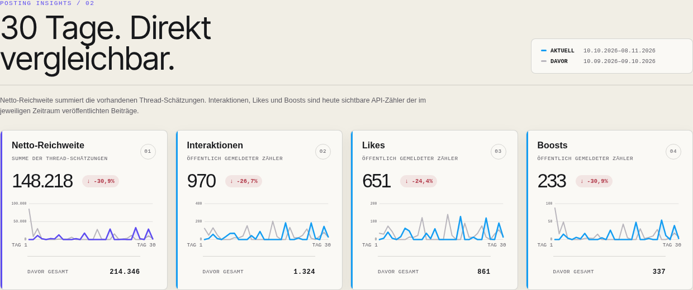
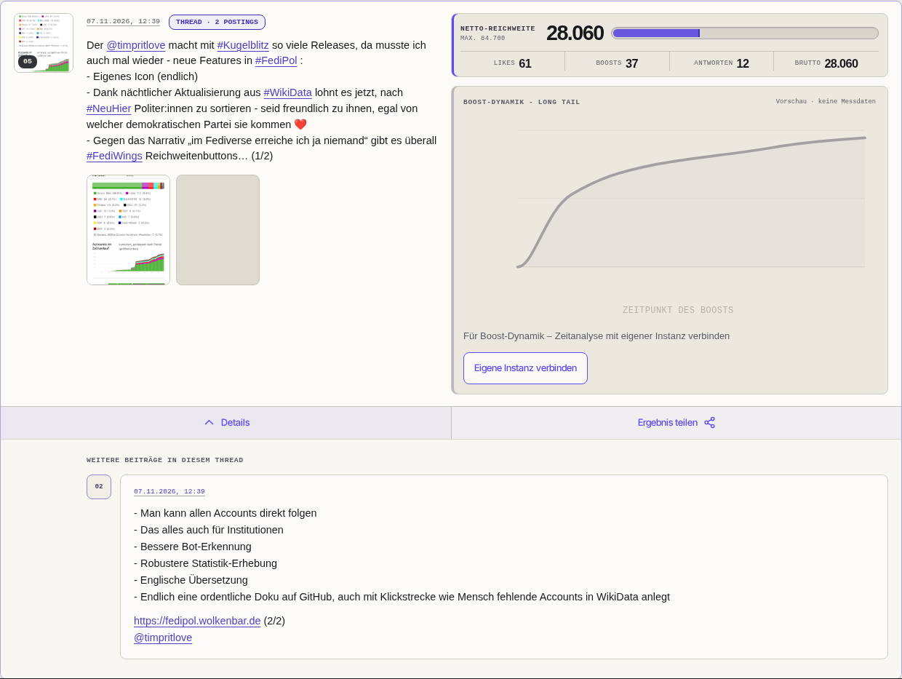
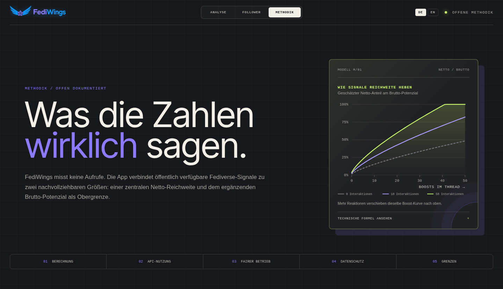
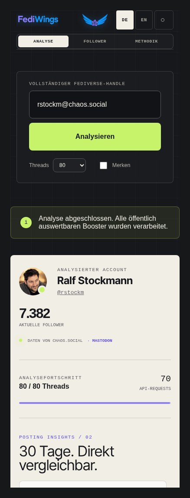
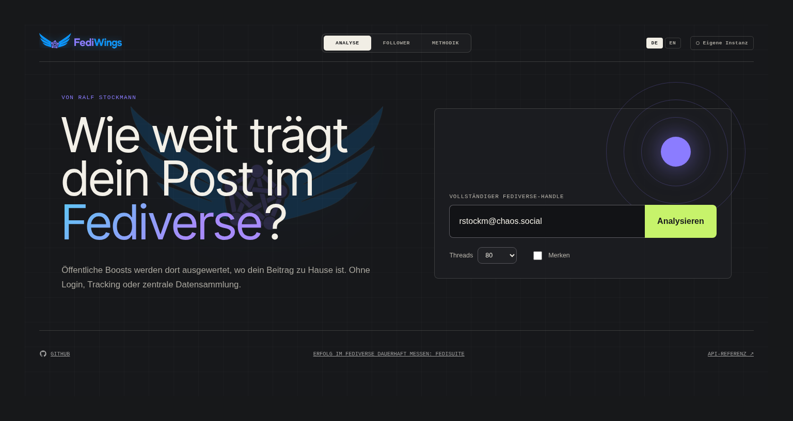
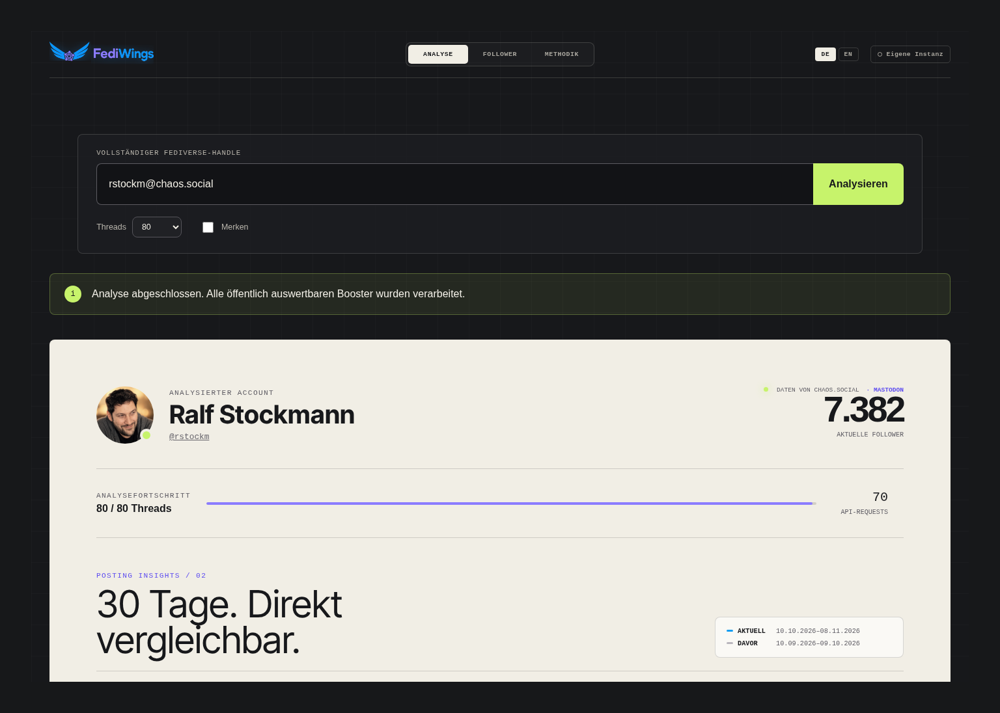
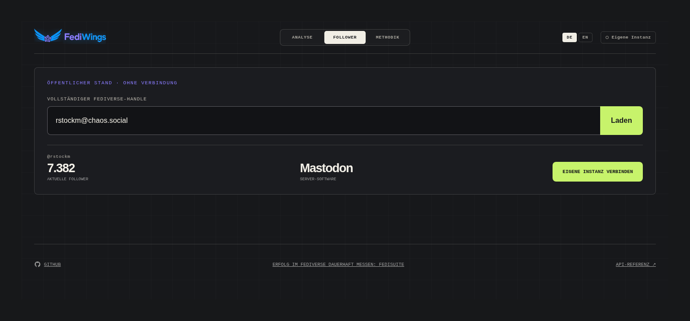
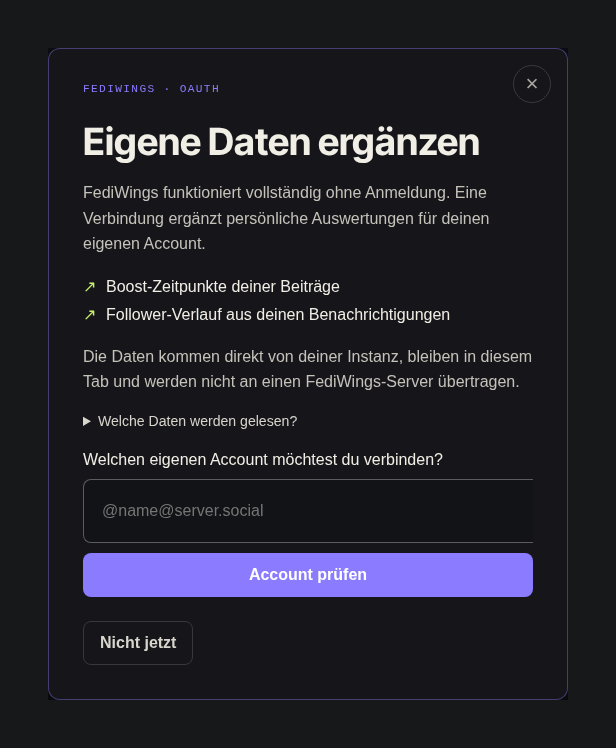

# FediWings

FediWings macht die öffentliche Verbreitung von Fediverse-Beiträgen sichtbar: mit einer geschätzten **Netto-Reichweite**, dem **Brutto-Potenzial** und vergleichbaren Posting-Kennzahlen. Es misst keine Views oder eindeutigen Leser:innen. Die statische Webanwendung lädt Daten direkt im Browser von den unterstützten Instanzen; für die öffentliche Analyse ist kein Login nötig.

**[App öffnen](https://rstockm.github.io/fediwings/)** · **[Mit rstockm@chaos.social ausprobieren](https://rstockm.github.io/fediwings/?handle=rstockm%40chaos.social)** · **[Methodik](https://rstockm.github.io/fediwings/?view=methodik)**

### Posting Insights: 30 Tage im Vergleich

Reichweite, Interaktionen, Likes und Boosts im Zeitverlauf — jeweils mit dem vorherigen 30-Tage-Zeitraum als Vergleich.



## Was die App kann

- **Accounts analysieren:** 10, 20, 40 oder 80 Threads auswählen; eigene Antwortketten werden zusammengefasst, Antworten an andere Accounts und Boosts aussortiert.
- **Beiträge verstehen:** Netto-Reichweite, Brutto-Potenzial, Likes, Boosts sowie Antworten/Quotes pro Thread; aufklappbare Texte und Medien.
- **30 Tage vergleichen:** Reichweitenschätzungen, Interaktionen, Likes und Boosts mit dem vorherigen 30-Tage-Zeitraum vergleichen; unvollständige Zeitfenster werden gekennzeichnet.
- **Ergebnisse teilen:** Einzelne Threads als Analyse-Link öffnen oder über den optionalen Card Service eine Vorschaukarte erstellen.
- **Eigene Instanz verbinden:** Optionaler Nur-Lese-Zugriff per OAuth für Follower-Verlauf und zeitlichen Boost-Verlauf eigener Beiträge. Die graue Long-Tail-Kurve ohne Verbindung ist ausdrücklich nur eine Vorschau, keine Messung.
- **Mobil und zweisprachig arbeiten:** Responsive Oberfläche, Deutsch/Englisch und optional lokal gemerkte Handles. Zuerst gilt eine gespeicherte Sprachwahl, sonst die deutsche/englische Browsersprache; andere Sprachen fallen auf Deutsch zurück.

## Einblicke

Aufgenommen am **08.11.2026** mit öffentlichen Live-Daten von **[rstockm@chaos.social](https://chaos.social/@rstockm)**. Zahlen und Beiträge sind Momentaufnahmen, keine festen Demo-Werte. Desktop: 1440 Pixel, Mobilansicht: 390 Pixel breit; einzelne Bereiche sind zugeschnitten.

### Threads und Reichweite im Detail

Ein aufgeklappter Thread zeigt die zusammengefassten Kennzahlen und die Folgebeiträge. Rechts ist ohne Anmeldung nur die ausdrücklich als **Vorschau · keine Messdaten** markierte Boost-Kurve zu sehen. Echte Boost-Zeitverläufe werden erst nach Verbindung der eigenen Instanz geladen.



### Das Modell hinter den Zahlen

Die Methodikseite erläutert Modell, Datenquellen und Grenzen; sie enthält auch die FediDay-Keynote und den Bezug zu FediSuite.



### Auch auf dem Smartphone



<details>
<summary>Weitere Ansichten: Start und Accountübersicht</summary>

Der vorausgefüllte Handle startet ohne explizites Autostart-Flag noch keine Analyse.





</details>

<details>
<summary>Follower und optionale Instanzverbindung</summary>

Die aktuelle Followerzahl ist öffentlich. Historische Diagramme und echte Boost-Zeitpunkte benötigen die Zustimmung zum Nur-Lese-Zugriff auf den eigenen Account. Die Aufnahmen zeigen den nicht angemeldeten Zustand; authentifizierte Verlaufsdiagramme sind hier nicht abgebildet.





</details>

Hinweise zur Aktualisierung und noch nicht abgebildeten Abläufen: [Screenshot-Dokumentation](docs/screenshots/README.md).

## Accounts per Deep Link öffnen

Ein Link kann den Analyse-Handle vorbefüllen, zum Beispiel:

```text
https://rstockm.github.io/fediwings/?handle=alice%40mastodon.social
```

Der Wert ist ein URL-kodierter Handle (`alice@mastodon.social`, optional mit
führendem `@`), keine Profil-URL. Ohne weitere Parameter startet die Analyse erst
nach Klick auf „Analysieren“; das Öffnen dieses Links sendet keine
instanzbezogenen Requests. Ungültige Deep Links werden ignoriert, die normale
Eingabe bleibt verfügbar.

Für einen unmittelbaren Analysestart kann genau einmal `autostart=1` ergänzt werden:

```text
https://rstockm.github.io/fediwings/?handle=alice%40mastodon.social&autostart=1
```

Der Autostart wird nur für einen gültigen Handle akzeptiert; doppelte Flags oder
andere Werte lösen ihn nicht aus. Vor dem Start wird das Flag aus der URL entfernt,
damit ein Reload die Analyse nicht erneut auslöst. Ein neuer Aufruf des ursprünglichen
Links startet wieder eine Analyse. OAuth- und Share-Aufrufe starten darüber keine
Analyse. Autostart-Links kann jeder erstellen: Sie sind keine Vertrauensprüfung
des Absenders und lösen direkt Anfragen an die Instanz aus, die dabei die IP-Adresse
der Besucher:innen sieht.

Die Übernahme akzeptiert genau einen `handle`-Parameter mit begrenzter Länge.
Benutzername und DNS-Labels werden validiert, internationale Domains zu Punycode
normalisiert. HTML-/URL-Payloads, Steuerzeichen, Zugangsdaten, Ports, Pfade,
IP-Adressen und lokale/reservierte Domain-Endungen werden abgewiesen. Der Wert
wird nur als Svelte-Inputwert verwendet, nie als HTML oder ausführbarer Code.
OAuth-Rücksprünge, andere Ansichten und fragmentbasierte Share-Links haben Vorrang.
Die syntaktische Domainprüfung ist keine DNS-/Netzwerk-Sandbox; für manuelle und
automatische Starts gelten die bestehenden API-, CORS- und Browser-Sicherheitsregeln.

## Entwicklung

Voraussetzung ist Node.js 22 oder neuer.

Der gezielte npm-Override fuer `svelte-i18n > esbuild` erzwingt eine gepatchte
esbuild-Version, solange svelte-i18n 4.0.1 noch die verwundbare 0.19-Reihe anfordert.
Er kann entfallen, sobald upstream eine sichere Version verwendet. Vitest 4.1.11
oder neuer behebt den Path-Traversal-Befund im Mocking-Modul.

```bash
npm ci
npm run dev
```

Der lokale Server ist anschließend unter `http://127.0.0.1:5173` erreichbar.

## Prüfen

Einheitlicher Prüfeinstieg (läuft lokal und in GitHub Actions identisch):

```bash
make check
```

Einzelne Schritte:

```bash
make audit          # Abhängigkeiten auf kritische Schwachstellen
make format         # Quellcode formatieren
make lint           # ESLint
make typecheck      # svelte-check
make test           # Unit- und Integrationstests
make test-browser   # Playwright-Smoke-Tests (Desktop, Mobile, 320px, axe)
make build          # Produktions-Build
```

Vor dem ersten Browser-Test die passende Chromium-Version installieren:

```bash
npx playwright install chromium
make build
make test-browser
```

## Betrieb auf GitHub Pages

Die App besteht aus statischen Dateien in `dist/`. Der Workflow [deploy.yml](.github/workflows/deploy.yml) prüft Pushes auf `master`/`main` vor dem Pages-Deployment; er lässt sich auch manuell starten. Vite setzt dabei den Repository-Unterpfad automatisch. Für lokale Builds gilt `/` als Basis.

Der optionale, separat betriebene Card Service wird beim Build über `VITE_CARD_SERVICE_URL` konfiguriert; GitHub Actions liest dafür die Repository-Variable `CARD_SERVICE_URL`. Ohne erreichbaren Service bleibt ein direkter Analyse-Link als Fallback verfügbar. Zum lokalen Prüfen des Builds: `npm run preview`.

## Unterstützte Server

FediWings analysiert Beiträge aus verschiedenen Teilen des Fediverse. Die App erkennt über NodeInfo die Software des Heimat-Servers und unterstützt Mastodon-API-kompatible Implementierungen direkt: **Mastodon**, **Pixelfed**, **Pleroma**, **Akkoma**, **GoToSocial**, **Friendica**, **Glitch-Soc** und **Hometown**. Die erkannte Software wird im Analyseergebnis angezeigt.

**Misskey**, **Sharkey**, **Firefish** und **Iceshrimp** werden ebenfalls über NodeInfo erkannt. Ihre Auswertung funktioniert derzeit jedoch nur auf Instanzen, die die verwendeten Mastodon-API-Endpunkte kompatibel bereitstellen. Für Pixelfed nutzt FediWings automatisch den anonymen Pixelfed-API-Pfad (`/api/pixelfed/v1/...`); da Pixelfed keine öffentlichen Booster-Listen bereitstellt, basiert die Brutto-Reichweite dort auf den Autor-Followern. Server ohne öffentliche Booster-Liste liefern ein gekennzeichnetes Teilergebnis. PeerTube (eigene Video-Sicht mit echten Views) ist als späteres Modul geplant.

**Friendica** verlangt für den Mastodon-Endpunkt `accounts/lookup` eine Anmeldung. FediWings umgeht das nicht, sondern löst Friendica-Accounts direkt über den anonymen Endpunkt `/api/v1/accounts/{name}` auf. Anonym sichtbar sind dort nur öffentliche und ungelistete Beiträge – kreisbeschränkte Beiträge („geschlossene Kreise") bleiben außen vor. Blockiert eine Instanz auch diesen anonymen Zugriff (etwa per `block_public`), erscheint eine klare Fehlermeldung statt eines technischen Fehlers.

## Sicherheit und Datenschutz

- Die FediWings-App ist eine Static App ohne eigene Accounts oder Cookies. Analysedaten bleiben im Browser; nur bewusst erstellte Share-Karten werden an den separaten Card Service übertragen.
- Die optionale „Eigene Instanz“-Verbindung (OAuth mit PKCE, Scopes `read:accounts read:notifications`) ergänzt den persönlichen Follower-Verlauf und datierte Boost-Benachrichtigungen für eigene Beiträge. Nach dem Login bestätigt FediWings den eigenen Account über `verify_credentials`; ein Login mit einem anderen als dem ausgewählten Account wird verworfen. Access-Token, feste Server-Origin und OAuth-Client liegen gemeinsam im `sessionStorage` des Tabs. Beim Abmelden wird der Token beim Server widerrufen und lokal gelöscht; bei HTTP 401 und beim Schließen des Tabs wird er lokal gelöscht.
- Damit ein Same-Tab-OAuth-Redirect eine laufende Ergebnisansicht nicht zerstört, kann FediWings den bereits öffentlichen Analysezustand einmalig für höchstens 15 Minuten im `sessionStorage` sichern. Der Snapshot ist an den OAuth-State gebunden und wird beim Rücksprung sofort gelöscht. Notification-Daten bleiben ausschließlich im Arbeitsspeicher.
- Beim Teilen kann die App einen separaten Card Service verwenden. Dorthin gehen ausschließlich der bewusst ausgelöste öffentliche Snapshot (Post-URL, Anzeigename, Handle, Avatar-URL, bereinigter Textanriss, Kennzahlen und Analysezeitpunkt) sowie ein optionales öffentliches Thumbnail. Der Dienst speichert den Snapshot und die daraus gerenderte PNG als öffentliche Share-URL; die entfernten Quellbilder werden nicht gespeichert. Content Warnings und sensible Medien übertragen weder Thumbnail noch verborgenen Text. Ist der Dienst nicht erreichbar, bleibt der fragmentbasierte direkte Share-Link nutzbar.
- Eine restriktive Content-Security-Policy wird beim Build eingebettet (`default-src 'none'`; Scripts und Styles nur vom eigenen Origin).
- Erlaubte ausgehende HTTPS-Ziele (nutzerinduziert):
  - Heimatinstanz des eingegebenen Handles (`https://<domain>/api/...`)
  - NodeInfo-Endpunkte derselben Domain (`.well-known/nodeinfo` und Profil-Link)
  - WebFinger-Endpunkt derselben Domain (`.well-known/webfinger`)
  - Instanz, die ein WebFinger-`self`-Link angibt
  - Nur nach ausdrücklicher Verbindung der eigenen Instanz: OAuth-Endpunkte derselben Instanz (`/api/v1/apps`, `/oauth/authorize`, `/oauth/token`, `/oauth/revoke`, `/api/v1/accounts/verify_credentials`, `/api/v1/notifications`)
  - Nur nach Aktivierung der Share-Funktion: konfigurierte HTTPS-Domain des FediWings Card Service für Request-Token und Snapshot-Erstellung
  - Keine Abfragen an die Heimatserver der Booster, keine Tracking- oder Analyseanbieter.
- Alle API-Antworten werden gegen feste Schemas validiert; Beitrags-HTML wird vor der Darstellung mit einer engen Allowlist sanitisiert (DOMPurify).
- Es werden keine Secrets oder Zugangsdaten im Build benötigt.

## Methodik

```text
Interaktionen = Likes + Antworten

Netto-Reichweite = min(
  Brutto-Reichweite,
  max(
    round(0,0165 × Brutto-Reichweite × (1 + 2 × Boosts + 2 × Quotes)^0,7314 × (1 + Interaktionen)^0,2214),
    Likes + Boosts + Quotes
  )
)

Brutto-Reichweite = Autor-Follower + Summe der Follower öffentlicher Booster
```

Die Netto-Reichweite ist der zentrale Wert der App. Sie überträgt eine Regression aus Instagram-Story-Daten heuristisch auf Beiträge im Fediverse. Boosts und – soweit vom Server gemeldet – Quotes gehen jeweils mit dem Faktor 2 ein. Das Modell ist nicht mit Fediverse-Impressionsdaten kalibriert. Die gerundete Schätzung wird mindestens auf die Summe aus Likes, Boosts und Quotes angehoben, bleibt aber durch das Brutto-Potenzial gedeckelt. Diese Untergrenze zählt Reaktionen, nicht zwingend verschiedene Personen. Auch das Brutto-Potenzial enthält Überschneidungen zwischen Followerkreisen und ist keine Impressionenzahl. Details zur Einordnung stehen auf der Methodik-Seite der App.

Die Ergebnisübersicht vergleicht Beiträge aus den letzten 30 Kalendertagen mit den 30 Tagen davor und gruppiert die Werte nach Veröffentlichungsdatum. An erster Stelle steht die Summe der bereits pro Thread berechneten Netto-Reichweiten; wegen möglicher Zielgruppenüberschneidungen ist sie keine Schätzung eindeutig erreichter Personen. Die weiteren Karten verwenden direkt gemeldete Postingzähler: Likes und Boosts sowie Likes, Boosts und Antworten zusammen als Interaktionen. Die Zähler zeigen den Stand zum Analysezeitpunkt, nicht den Zeitpunkt einzelner Reaktionen. Reicht die geladene Historie oder die Auswahl der 80 analysierten Threads nicht bis zum Beginn eines Zeitfensters, zeigt FediWings dafür weder eine Teilsumme noch eine irreführende Kurve. Eine Prozentabweichung entfällt außerdem, wenn die Vorperiodensumme null ist.

Für den eigenen, verbundenen Account können aufgeklappte Beiträge zusätzlich Zeitpunkte aus `reblog`-Benachrichtigungen zeigen. Diese Historie ist von den öffentlichen Boost-Zählern getrennt und kann durch gelöschte, gefilterte oder noch nicht geladene Notifications unvollständig sein. Zunächst wird eine Seite geladen; ältere Seiten nur auf ausdrückliche Aktion, maximal zehn pro Tab-Sitzung.

Standardmäßig werden bis zu 80 Threads analysiert. Antworten auf fremde Beiträge werden bereits beim Laden verworfen; Selbst-Antworten bleiben erhalten und werden mit dem eigenen Ausgangsbeitrag zu einem Thread gruppiert.

## Architekturentscheidungen

Begründete Abweichungen vom Referenz-Stack (Svelte 5, handgeschriebenes Token-CSS statt Tailwind, svelte-check als Typecheck, keine IndexedDB) sind in der internen Architekturdokumentation des Projekts festgehalten, die nicht Teil dieses öffentlichen Repos ist.
