# FediWings

FediWings macht die öffentliche Verbreitung von Fediverse-Beiträgen sichtbar: mit einer geschätzten **Netto-Reichweite**, dem **Brutto-Potenzial** und vergleichbaren Posting-Kennzahlen. Es misst keine Views oder eindeutigen Leser:innen. Die statische Webanwendung lädt Daten direkt im Browser von den unterstützten Instanzen; für die öffentliche Analyse ist kein Login nötig.

**[App öffnen](https://rstockm.github.io/fediwings/)** · **[Mit rstockm@chaos.social ausprobieren](https://rstockm.github.io/fediwings/?handle=rstockm%40chaos.social)** · **[Methodik](https://rstockm.github.io/fediwings/?view=methodik)**

### Posting Insights: 30 Tage im Vergleich

Reichweite, Interaktionen, Likes und Boosts im Zeitverlauf — jeweils mit dem vorherigen 30-Tage-Zeitraum als Vergleich.

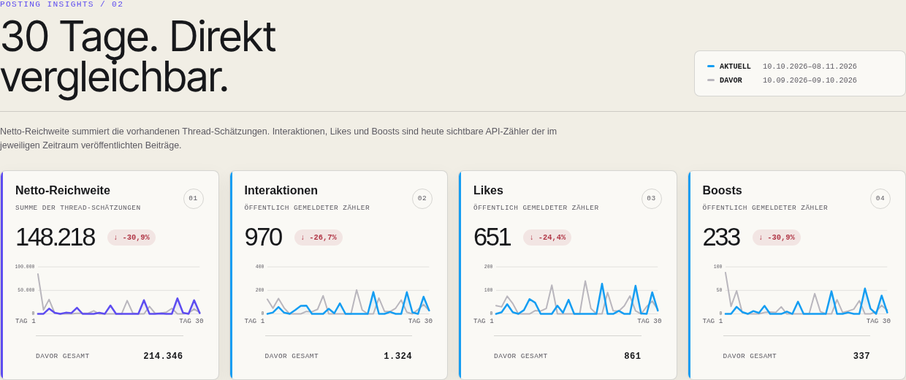

## Was die App kann

- **Accounts analysieren:** 10, 20, 40 oder 80 Threads auswählen; eigene Antwortketten werden zusammengefasst, Antworten an andere Accounts und Boosts aussortiert.
- **Beiträge verstehen:** Netto-Reichweite, Brutto-Potenzial, Likes, Boosts sowie Antworten/Quotes pro Thread; aufklappbare Texte und Medien.
- **30 Tage vergleichen:** Reichweitenschätzungen, Interaktionen, Likes und Boosts mit dem vorherigen 30-Tage-Zeitraum vergleichen; unvollständige Zeitfenster werden gekennzeichnet.
- **Ergebnisse teilen:** Einzelne Threads als Analyse-Link öffnen oder über den optionalen Card Service eine Vorschaukarte erstellen.
- **Reports:** Erst nach Verbindung der eigenen Instanz erscheinen Statistiken und starten Jahresbericht und Follower-Verlauf gemeinsam. Reports zeigen monatliche Postings, Interaktionen, modellierte Reichweite und Engagement als Tabelle und Balkendiagramme; oben stehen PDF-Bericht, Excel-Kopie und CSV als kompakte, direkt sichtbare Exportaktionen. Ein Jahreswechsel lädt den Live-Report automatisch neu. „Report speichern“ legt den aktuellen Stand lokal ab; pro Account und Jahr gibt es einen Stand, dessen Datum die Ansicht ausweist und an dem er sich direkt löschen lässt. Follower-Stichtage bleiben beim Löschen des Stands erhalten. Das Handle-Feld bleibt auch mit Verbindung bedienbar: Ein anderer Account lässt sich wählen und per Login verbinden; die Auswahl gilt stabil auch für die Analyse.
- **Executive-PDF:** Lokal erstellter A4-Managementbericht mit Executive Summary, Monatsentwicklung, vollständigen Tabellen für jede Datengrafik, Community, Top 5 öffentlichen Threads und kompakter Methodik. Account-Avatar und vorhandene Beitragsbilder werden eingebettet, bei fehlenden Medien greifen Initialen beziehungsweise Text. Berichtstitel, Organisation und Deutsch/Englisch sind wählbar; Vorschau und Download verwenden denselben Stand. Keine Übertragung an einen PDF-Dienst.
- **Eigene Instanz verbinden:** Optionaler Nur-Lese-Zugriff per OAuth für Follower-Verlauf und zeitlichen Boost-Verlauf eigener Beiträge. Die graue Long-Tail-Kurve ohne Verbindung ist ausdrücklich nur eine Vorschau, keine Messung.
- **Mobil und zweisprachig arbeiten:** Responsive Oberfläche, Deutsch/Englisch und optional lokal gemerkte Handles. Zuerst gilt eine gespeicherte Sprachwahl, sonst die deutsche/englische Browsersprache; andere Sprachen fallen auf Deutsch zurück.

## Einblicke

Die älteren Aufnahmen vom **08.11.2026** verwenden öffentliche Live-Daten von **[rstockm@chaos.social](https://chaos.social/@rstockm)**. Zahlen und Beiträge sind Momentaufnahmen, keine festen Demo-Werte. Desktop-Viewport: 1440 Pixel, Mobilansicht: 390 Pixel breit; einzelne Bereiche sind zugeschnitten. Aktualisierte Aufnahmen und Ausnahmen stehen bei den jeweiligen Bildern und in der Screenshot-Dokumentation.

### Executive Report als PDF

**Demo vom 18.11.2026 mit synthetischen Daten**, keine authentifizierte Live-Aufnahme:
[Beispielbericht Deutsch](docs/examples/report-demo-de.pdf) ·
[Example report English](docs/examples/report-demo-en.pdf).
Die Berichte sind durchsuchbar, enthalten eingebettete Inter-Tight-Schriften und
klickbare Original-Links. Alle Grafiken sind zusätzlich vollständig tabelliert;
Community- und Kennzahlenwerte stehen gemeinsam in der Monatstabelle. Beim
Follower-Zuwachs erscheint genau ein Wert pro Monat, ohne kleine Zweitwerte;
gleich breite Tabellenziffern sorgen für sauber ausgerichtete Zahlen.
Die Titelseite zeigt fünf Kennzahlen einschließlich Follower-Stand mit
farbigen Veränderungsindikatoren. Reichweite, Interaktionen und Threads
vergleichen Jahressummen mit dem Vorjahr (YTD: gleicher Zeitraum);
Follower und Engagement vergleichen Januar und Dezember beziehungsweise den
letzten abgeschlossenen Monat. Vorjahresdaten werden erst beim PDF-Start geladen,
nicht bei jedem Seitenaufruf. Fehlende Vergleichsdaten werden nicht geschätzt.
Die Balken übernehmen Grün/Orange und die relative Farbintensität der Online-Version.
Jede Grafik trägt eine beschriftete, gerundete Werteachse; beim Follower-Stand ist
sie auf den Jahresbereich vergrößert und ausdrücklich als „Achse nicht bei null“
gekennzeichnet. Die Top-5-Beiträge zeigen, sofern vorhanden, das Beitragsbild und
weisen Antworten, Boosts, Likes und Zitate einzeln aus; Tabellenköpfe stehen
rechtsbündig über ihren Zahlenspalten. Der Account-Avatar erscheint auf der
Titelseite, ohne verfügbares Bild als Initialenfläche.

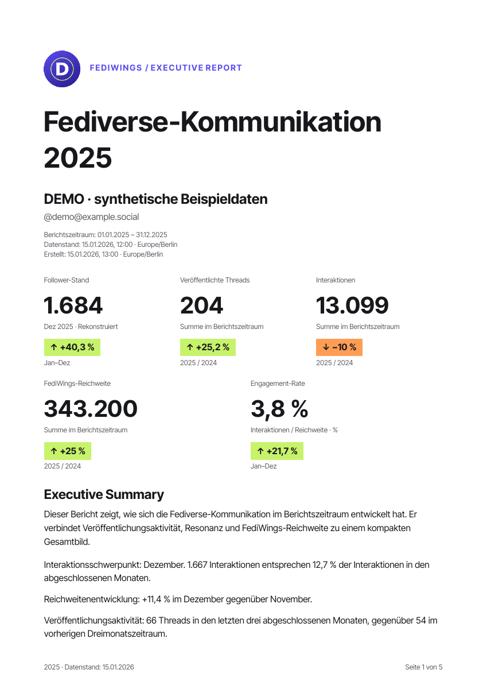

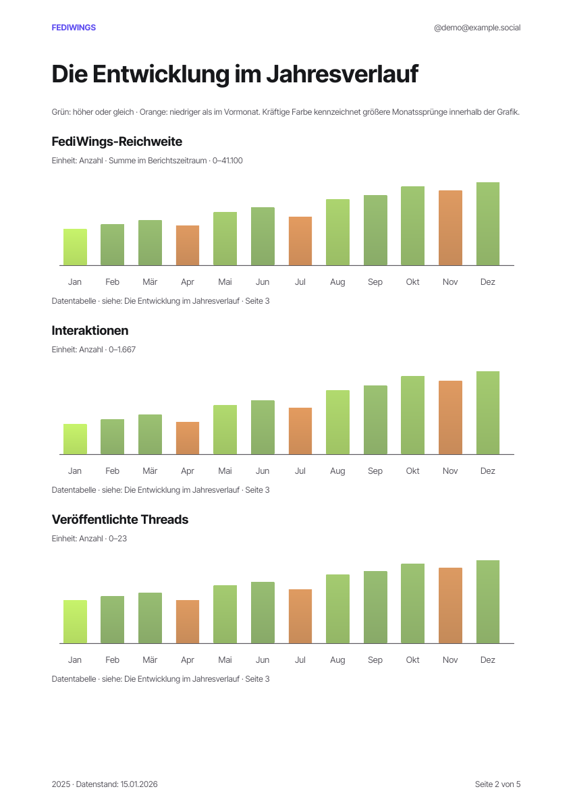

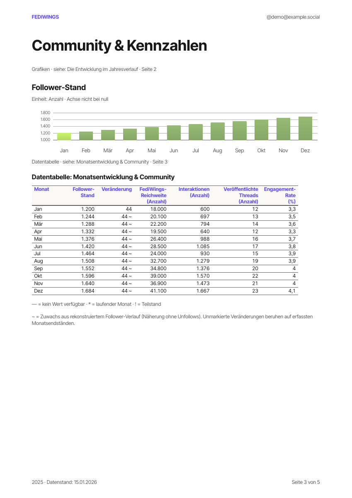


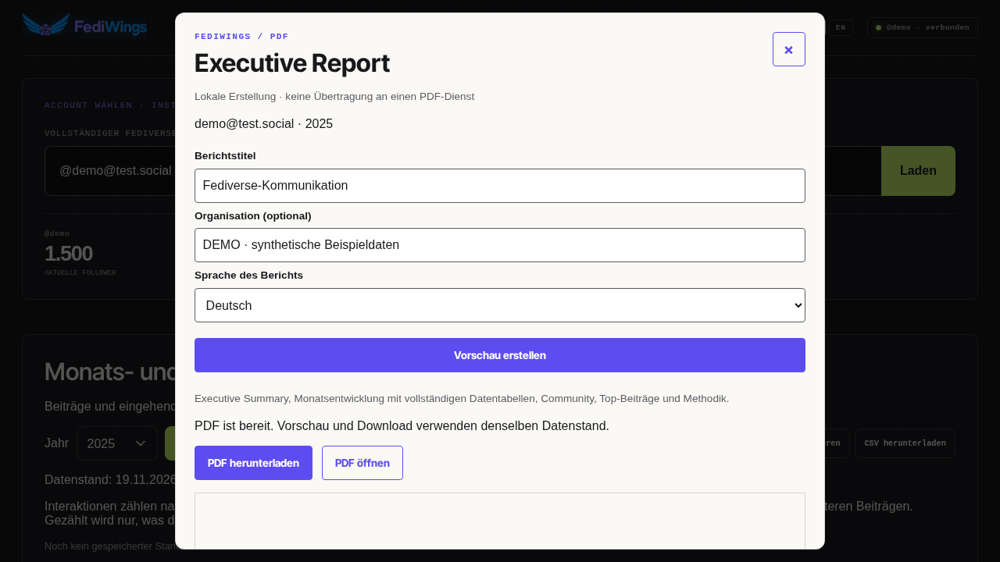

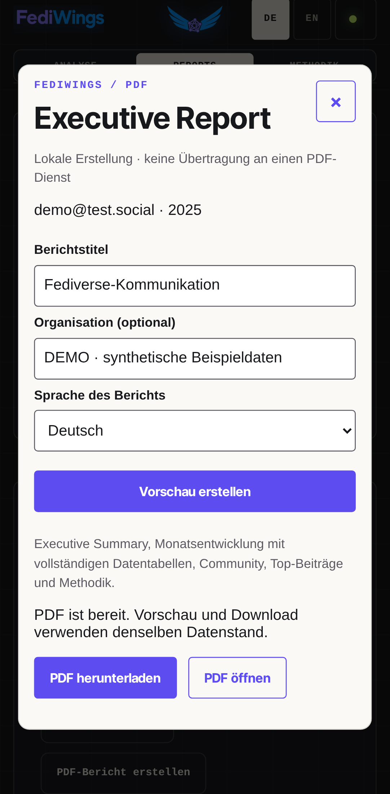

Neue gespeicherte Reports enthalten den PDF-Datenstand einschließlich maximal
fünf öffentlichen Beitragsauszügen. Ältere Reports bleiben exportierbar; dort
fehlende Beitragsdetails und historische Followerquellen werden nicht heimlich
nachgeladen. Nicht unterstützte Schriftzeichen werden sichtbar als Unicode-Code
ausgegeben, statt lautlos zu verschwinden. Mobil kann das PDF direkt geöffnet
werden, auch ohne eingebetteten PDF-Viewer. Eine PDF/UA-Konformität ist nicht
nachgewiesen. Details und Prüfkommandos: [PDF-Modul](docs/pdf-export.md).

### Monats- und Jahresreports

Der Einstieg hat nur eine Aktion: **Eigene Instanz verbinden**. Nach Auswahl des
Handles öffnet sich die Freigabe; erst nach erfolgreicher Verbindung erscheinen
Statistiken. Beim Trennen der Verbindung werden sie wieder ausgeblendet.
Die Accountübersicht nennt die erkannte Server-Software, etwa Mastodon oder
Pixelfed, auch nach Login und Neuladen. Schlägt die Erkennung fehl, steht dort
ausdrücklich „Nicht erkannt“ statt der unspezifischen Protokollangabe „ActivityPub“.

Report und Follower-Verlauf teilen sich **eine Fortschrittsanzeige und eine
Abbrechen-Aktion**. Tabelle und Diagramme erscheinen gemeinsam nach Abschluss
beider Abrufe; verfügbare Daten bleiben bei einem Teilfehler mit Hinweis nutzbar.
Solange die Seitenzahl unbekannt ist, läuft die Anzeige ohne Prozentwert.
Während der Reichweitenberechnung zeigt sie den Anteil der bearbeiteten Beiträge,
nicht einen geschätzten Gesamtfortschritt.

Account, geladene Beiträge und vollständige Jahresanalysen werden bis zu fünf
Minuten im Arbeitsspeicher für denselben verbundenen Account wiederverwendet.
Ein Jahreswechsel nutzt vorhandene Daten und lädt bei verfügbarer Paginierung nur
fehlende ältere Beitragsseiten nach. **Live-Report laden** beziehungsweise
**Verlauf neu laden** aktualisiert beide Datenquellen ausdrücklich. Ein
Browser-Reload leert diese flüchtigen Caches; lokale gespeicherte Reports bleiben
erhalten.

**UI-Demo, aufgenommen am 18.11.2026:** Die folgenden aktuellen Aufnahmen verwenden
kontrollierte Testantworten für `alice@test.social`, keine echte Anmeldung und
keine privaten Accountdaten. Sie zeigen den gemeinsamen Ladezustand auf Desktop
und Mobilgerät; authentifizierte Live-Aufnahmen sind damit nicht abgedeckt.

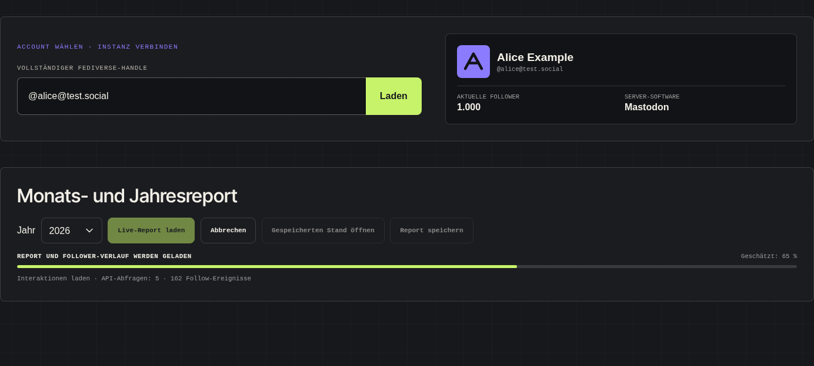

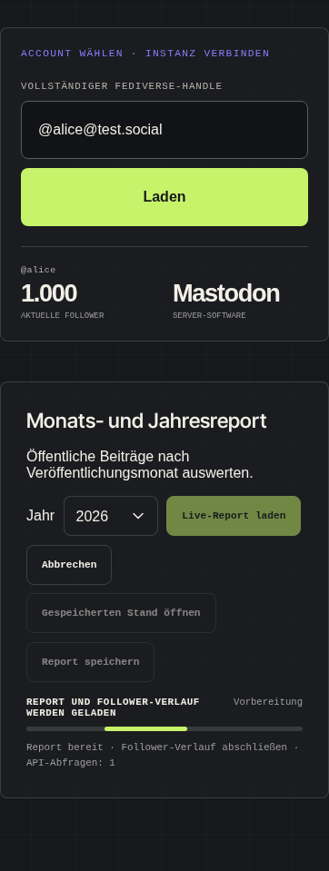

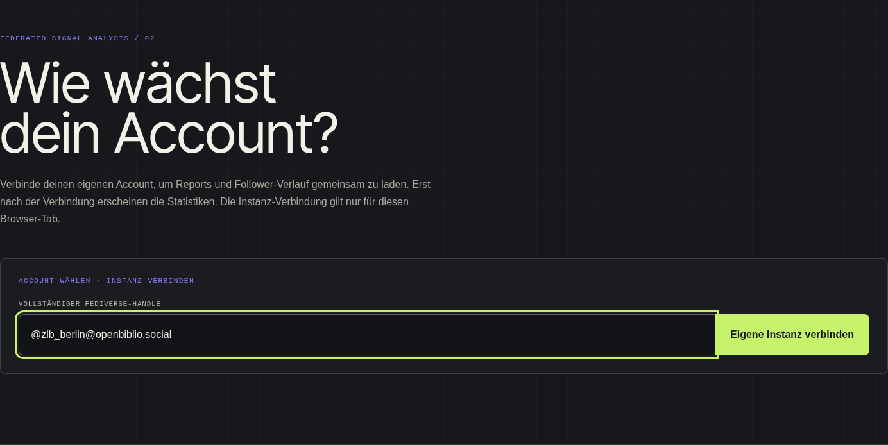

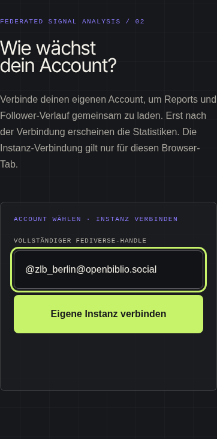

Die folgenden **UI-Demos vom 19.11.2026** verwenden kontrollierte Beispieldaten. Im April zeigt der Report zwei Reaktionen auf ältere Beiträge bei null neuen Postings. Januar ist unbekannt, Februar ein Teilstand. Der mobile Tabellenbereich ist horizontal scrollbar. Authentifizierte Live-Aufnahmen sind nicht enthalten.

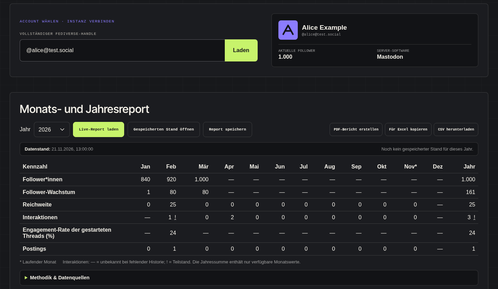

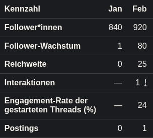

Die Balkendiagramme zeigen dieselben Monatswerte mit gerundeten Achsenskalen.
Die Balkenfarbe vergleicht jeden Monat mit seinem direkten Vormonat: Grün bedeutet
einen höheren Wert, Orange einen niedrigeren. Kleine Sprünge erscheinen in schwachem
Grün beziehungsweise Orange, große Sprünge in kräftiger Farbe. Die Intensität
orientiert sich am größten absoluten Monatsunterschied des jeweiligen Diagramms.
Fehlende Interaktionswerte bleiben im Diagramm und in der Tabelle offen. Der
Mittelwert der Interaktionen berücksichtigt nur abgedeckte Monate. Für andere
Kennzahlen zählen fehlende Monatswerte weiterhin als 0 im Diagramm.
Eine gestrichelte violette Linie markiert den Mittelwert der gezeigten Monate; sein
Wert steht rechts oben in der Diagrammkarte und überdeckt so keine Balken. Die
Mittelwerte von Follower-Wachstum, Reichweite und Interaktionen erscheinen als ganze
Zahlen, Engagement und Postings behalten eine Nachkommastelle. Beim Überfahren
eines Monats zeigt eine Führungslinie den Treffer, ein Tooltip nennt Monat und Wert. Das Diagramm der
absoluten Follower-Zahlen zeigt keinen Mittelwert.
Bei verbundener Instanz füllen der verankerte Follower-Verlauf und monatliche
Follow-Benachrichtigungen fehlende Werte in den beiden Follower-Zeilen. Gespeicherte
Monatsendstände haben Vorrang. Der Verlauf berücksichtigt keine Unfollows;
Benachrichtigungen können auch Follow-Anfragen enthalten. Außerhalb der
vorhandenen Historie bleiben Werte leer.

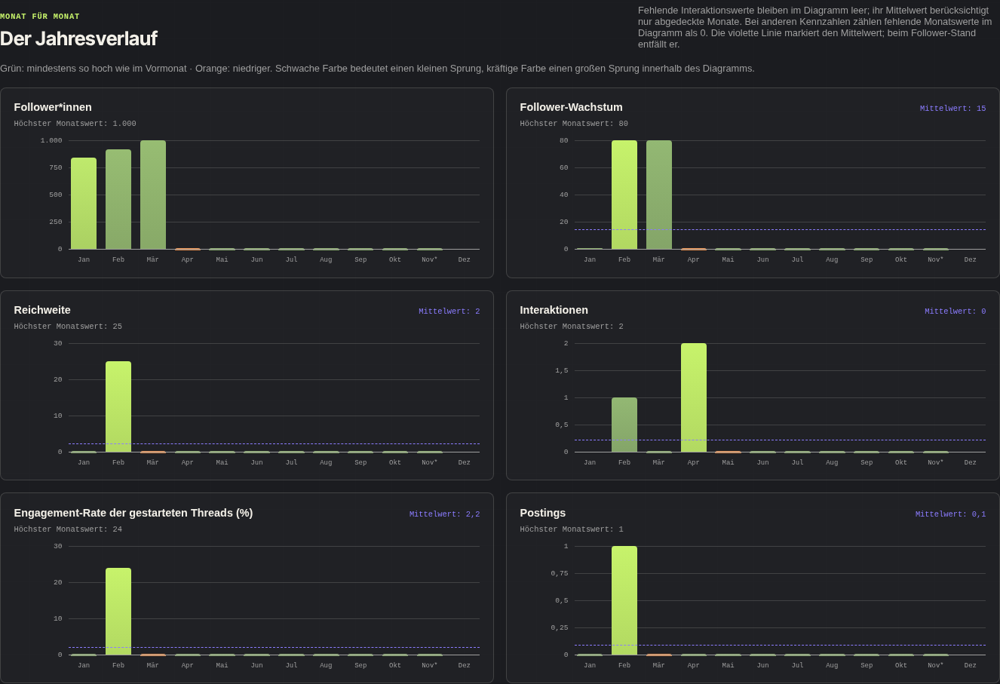

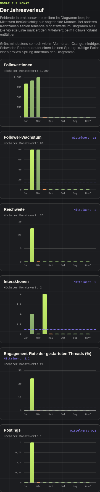

### Ergebnisse als Share-Card

Eine echte, mit FediWings erstellte Vorschaukarte für einen öffentlichen Thread: mit Profil, Beitragstext, Vorschaubild und Reichweitenkennzahlen. Die Karte lässt sich als Bildvorschau über einen öffentlichen Share-Link teilen.

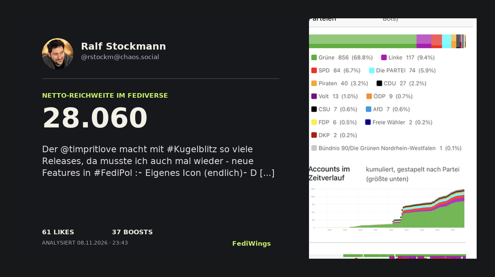

### Threads und Reichweite im Detail

Ein aufgeklappter Thread zeigt die zusammengefassten Kennzahlen und die Folgebeiträge. Rechts ist ohne Anmeldung nur die ausdrücklich als **Vorschau · keine Messdaten** markierte Boost-Kurve zu sehen. Echte Boost-Zeitverläufe werden erst nach Verbindung der eigenen Instanz geladen.

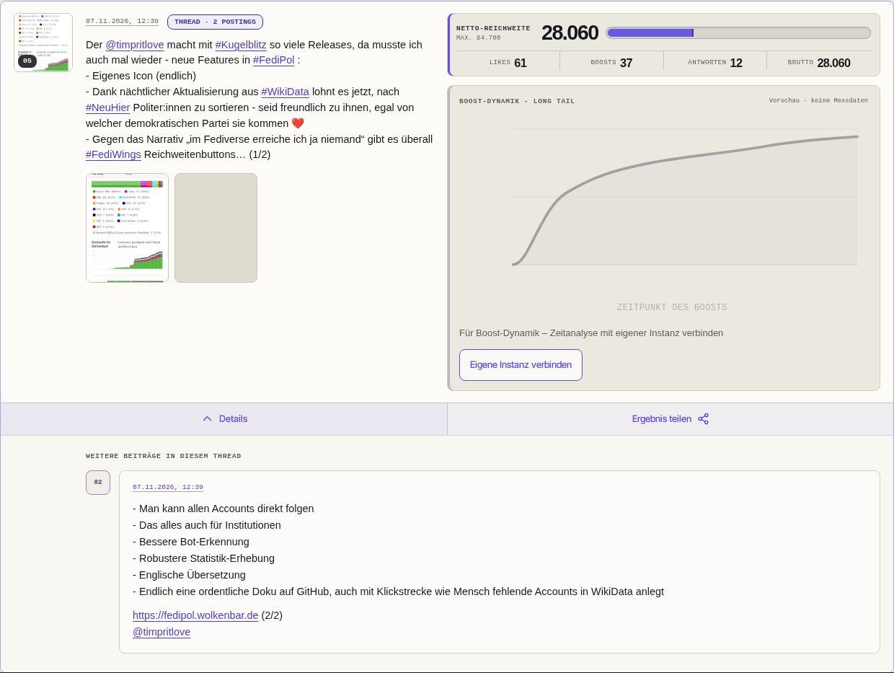

### Das Modell hinter den Zahlen

Die Methodikseite erläutert Modell, Datenquellen und Grenzen; sie enthält auch die FediDay-Keynote und den Bezug zu FediSuite.

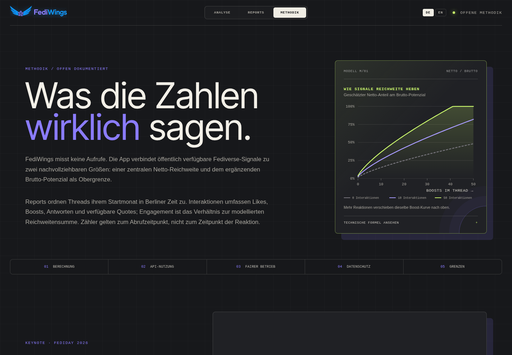

### Auch auf dem Smartphone

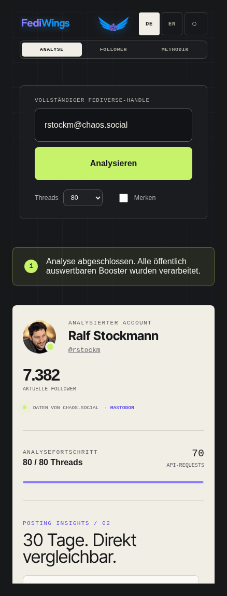

<details>
<summary>Weitere Ansichten: Start und Accountübersicht</summary>

Der vorausgefüllte Handle startet ohne explizites Autostart-Flag noch keine Analyse.

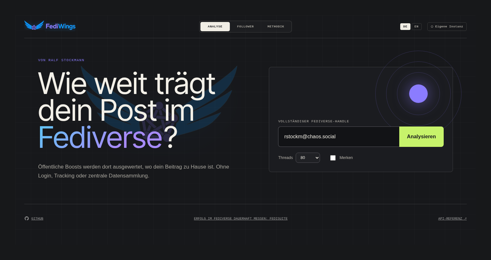

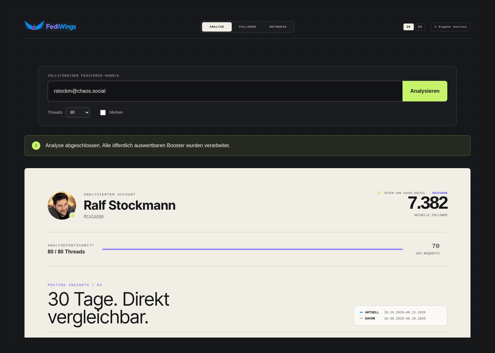

</details>

<details>
<summary>Follower und optionale Instanzverbindung</summary>

Die aktuelle Followerzahl ist öffentlich. Historische Diagramme und echte Boost-Zeitpunkte benötigen die Zustimmung zum Nur-Lese-Zugriff auf den eigenen Account. Die Aufnahmen zeigen den nicht angemeldeten Zustand; authentifizierte Verlaufsdiagramme sind hier nicht abgebildet. Die ältere Aufnahme zeigt noch die frühere Reiterbezeichnung „Follower“ statt „Reports“.

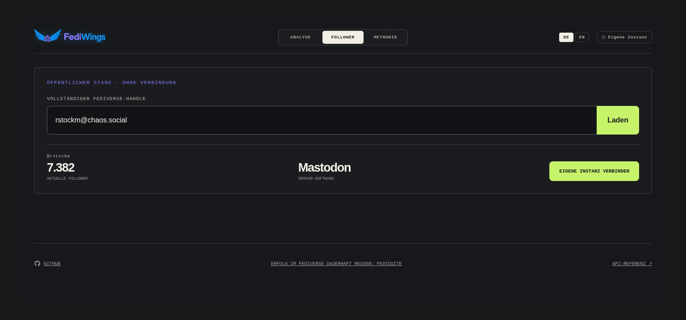

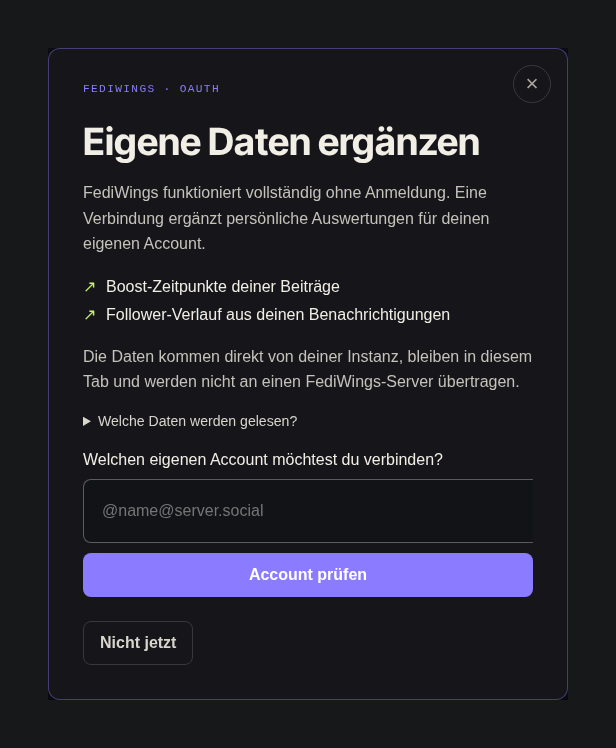

</details>

Hinweise zur Aktualisierung und noch nicht abgebildeten Abläufen: [Screenshot-Dokumentation](docs/screenshots/README.md).

## Accounts per Deep Link öffnen

Ein Link kann den Analyse-Handle vorbefüllen, zum Beispiel:

```text
https://rstockm.github.io/fediwings/?handle=alice%40mastodon.social
```

Der Wert ist ein URL-kodierter Handle (`alice@mastodon.social`, optional mit
führendem `@`), keine Profil-URL. Ohne weitere Parameter startet die Analyse erst
nach Klick auf „Analysieren“; das Öffnen dieses Links sendet keine
instanzbezogenen Requests. Ungültige Deep Links werden ignoriert, die normale
Eingabe bleibt verfügbar.

Für einen unmittelbaren Analysestart kann genau einmal `autostart=1` ergänzt werden:

```text
https://rstockm.github.io/fediwings/?handle=alice%40mastodon.social&autostart=1
```

Der Autostart wird nur für einen gültigen Handle akzeptiert; doppelte Flags oder
andere Werte lösen ihn nicht aus. Vor dem Start wird das Flag aus der URL entfernt,
damit ein Reload die Analyse nicht erneut auslöst. Ein neuer Aufruf des ursprünglichen
Links startet wieder eine Analyse. OAuth- und Share-Aufrufe starten darüber keine
Analyse. Autostart-Links kann jeder erstellen: Sie sind keine Vertrauensprüfung
des Absenders und lösen direkt Anfragen an die Instanz aus, die dabei die IP-Adresse
der Besucher:innen sieht.

Die Übernahme akzeptiert genau einen `handle`-Parameter mit begrenzter Länge.
Benutzername und DNS-Labels werden validiert, internationale Domains zu Punycode
normalisiert. HTML-/URL-Payloads, Steuerzeichen, Zugangsdaten, Ports, Pfade,
IP-Adressen und lokale/reservierte Domain-Endungen werden abgewiesen. Der Wert
wird nur als Svelte-Inputwert verwendet, nie als HTML oder ausführbarer Code.
OAuth-Rücksprünge, andere Ansichten und fragmentbasierte Share-Links haben Vorrang.
Die syntaktische Domainprüfung ist keine DNS-/Netzwerk-Sandbox; für manuelle und
automatische Starts gelten die bestehenden API-, CORS- und Browser-Sicherheitsregeln.

## Entwicklung

Voraussetzung ist Node.js 22 oder neuer.

Der gezielte npm-Override fuer `svelte-i18n > esbuild` erzwingt eine gepatchte
esbuild-Version, solange svelte-i18n 4.0.1 noch die verwundbare 0.19-Reihe anfordert.
Er kann entfallen, sobald upstream eine sichere Version verwendet. Vitest 4.1.11
oder neuer behebt den Path-Traversal-Befund im Mocking-Modul.

```bash
npm ci
npm run dev
```

Der lokale Server ist anschließend unter `http://127.0.0.1:5173` erreichbar.

## Prüfen

Einheitlicher Prüfeinstieg (läuft lokal und in GitHub Actions identisch):

```bash
make check
```

Einzelne Schritte:

```bash
make audit          # Hohe/kritische Befunde; eng begrenzte genehmigte Ausnahme beachten
make format         # Quellcode formatieren
make lint           # ESLint
make typecheck      # svelte-check
make test           # Unit- und Integrationstests
make test-browser   # Playwright-Smoke-Tests (Desktop, Mobile, 320px, axe)
make build          # Produktions-Build
```

Die automatisierten Reports- und OAuth-Browserprüfungen verwenden kontrollierte
API-Antworten; sie ersetzen keinen manuellen Test gegen eine konkrete Live-Instanz.

Vor dem ersten Browser-Test die passende Chromium-Version installieren:

```bash
npx playwright install chromium
make build
make test-browser
```

## Betrieb auf GitHub Pages

Die App besteht aus statischen Dateien in `dist/`. Der Workflow [deploy.yml](.github/workflows/deploy.yml) prüft Pushes auf `master`/`main` vor dem Pages-Deployment; er lässt sich auch manuell starten. Vite setzt dabei den Repository-Unterpfad automatisch. Für lokale Builds gilt `/` als Basis.

Der optionale, separat betriebene Card Service wird beim Build über `VITE_CARD_SERVICE_URL` konfiguriert; GitHub Actions liest dafür die Repository-Variable `CARD_SERVICE_URL`. Ohne erreichbaren Service bleibt ein direkter Analyse-Link als Fallback verfügbar. Zum lokalen Prüfen des Builds: `npm run preview`.

## Unterstützte Server

FediWings analysiert Beiträge aus verschiedenen Teilen des Fediverse. Die App erkennt über NodeInfo die Software des Heimat-Servers und unterstützt Mastodon-API-kompatible Implementierungen direkt: **Mastodon**, **Pixelfed**, **Pleroma**, **Akkoma**, **GoToSocial**, **Friendica**, **Glitch-Soc** und **Hometown**. Die erkannte Software wird im Analyseergebnis angezeigt.

**Misskey**, **Sharkey**, **Firefish** und **Iceshrimp** werden ebenfalls über NodeInfo erkannt. Ihre Auswertung funktioniert derzeit jedoch nur auf Instanzen, die die verwendeten Mastodon-API-Endpunkte kompatibel bereitstellen. Für Pixelfed nutzt FediWings automatisch den anonymen Pixelfed-API-Pfad (`/api/pixelfed/v1/...`); da Pixelfed keine öffentlichen Booster-Listen bereitstellt, basiert die Brutto-Reichweite dort auf den Autor-Followern. Server ohne öffentliche Booster-Liste liefern ein gekennzeichnetes Teilergebnis. PeerTube (eigene Video-Sicht mit echten Views) ist als späteres Modul geplant.

**Friendica** verlangt für den Mastodon-Endpunkt `accounts/lookup` eine Anmeldung. FediWings umgeht das nicht, sondern löst Friendica-Accounts direkt über den anonymen Endpunkt `/api/v1/accounts/{name}` auf. Anonym sichtbar sind dort nur öffentliche und ungelistete Beiträge – kreisbeschränkte Beiträge („geschlossene Kreise") bleiben außen vor. Blockiert eine Instanz auch diesen anonymen Zugriff (etwa per `block_public`), erscheint eine klare Fehlermeldung statt eines technischen Fehlers.

## Sicherheit und Datenschutz

### Software-Stückliste und Lizenzen

Die versionierte [CycloneDX-SBOM](compliance/sbom.cdx.json) erfasst npm-Abhängigkeiten
einschließlich Build-/Testwerkzeugen sowie die lokalen Webfonts. Mit `make sbom`
wird sie aktualisiert; `make sbom-check` prüft Schema und Aktualität auch in CI.
Umfang, Lizenzfolgen und offene Entscheidungen stehen in
[compliance/README.md](compliance/README.md). Für den eigenen FediWings-Code ist
bislang keine ausdrückliche Projektlizenz festgelegt.

Das Deployment prüft weiterhin alle hohen und kritischen npm-Auditbefunde.
Für das ungepatchte Picomatch-Advisory `GHSA-fc5q-39xc-vjpf` wurde am 18.11.2026
eine ausschließlich auf Entwicklungswerkzeuge begrenzte Ausnahme genehmigt,
gültig bis zum 18.12.2026 (ausschließlich). Andere Advisories, Produktionspfade
oder kritische Eskalationen bleiben blockiert. Begründung und Ablaufkontrolle:
[Audit-Ausnahme](compliance/README.md#befristete-audit-ausnahme).

### Sicherheitsmaßnahmen

- Die FediWings-App ist eine Static App ohne eigene Accounts oder Cookies. Analysedaten bleiben im Browser; nur bewusst erstellte Share-Karten werden an den separaten Card Service übertragen.
- Reports und datierte Followerstände werden nur auf ausdrückliche Aktion lokal in IndexedDB gespeichert; keine Tokens oder Benachrichtigungen werden in Report-Snapshots abgelegt. Gespeicherte Reports können gelöscht werden, Follower-Stichtage bleiben dabei erhalten.
- Die optionale „Eigene Instanz“-Verbindung (OAuth mit PKCE, Scopes `read:accounts read:notifications`) ergänzt den persönlichen Follower-Verlauf und datierte Boost-Benachrichtigungen für eigene Beiträge. Nach dem Login bestätigt FediWings den eigenen Account über `verify_credentials`; ein Login mit einem anderen als dem ausgewählten Account wird verworfen. Access-Token, feste Server-Origin und OAuth-Client liegen gemeinsam im `sessionStorage` des Tabs. Beim Abmelden wird der Token beim Server widerrufen und lokal gelöscht; bei HTTP 401 und beim Schließen des Tabs wird er lokal gelöscht.
- Damit ein Same-Tab-OAuth-Redirect eine laufende Ergebnisansicht nicht zerstört, kann FediWings den bereits öffentlichen Analysezustand einmalig für höchstens 15 Minuten im `sessionStorage` sichern. Der Snapshot ist an den OAuth-State gebunden und wird beim Rücksprung sofort gelöscht. Notification-Daten bleiben ausschließlich im Arbeitsspeicher.
- Beim Teilen kann die App einen separaten Card Service verwenden. Dorthin gehen ausschließlich der bewusst ausgelöste öffentliche Snapshot (Post-URL, Anzeigename, Handle, Avatar-URL, bereinigter Textanriss, Kennzahlen und Analysezeitpunkt) sowie ein optionales öffentliches Thumbnail. Der Dienst speichert den Snapshot und die daraus gerenderte PNG als öffentliche Share-URL; die entfernten Quellbilder werden nicht gespeichert. Content Warnings und sensible Medien übertragen weder Thumbnail noch verborgenen Text. Ist der Dienst nicht erreichbar, bleibt der fragmentbasierte direkte Share-Link nutzbar.
- Eine restriktive Content-Security-Policy wird beim Build eingebettet (`default-src 'none'`; Scripts und Styles nur vom eigenen Origin; Blob-Worker nur für die lokale PDF-Kompression).
- Erlaubte ausgehende HTTPS-Ziele (nutzerinduziert):
  - Heimatinstanz des eingegebenen Handles (`https://<domain>/api/...`)
  - NodeInfo-Endpunkte derselben Domain (`.well-known/nodeinfo` und Profil-Link)
  - WebFinger-Endpunkt derselben Domain (`.well-known/webfinger`)
  - Instanz, die ein WebFinger-`self`-Link angibt
  - Nur nach ausdrücklicher Verbindung der eigenen Instanz: OAuth-Endpunkte derselben Instanz (`/api/v1/apps`, `/oauth/authorize`, `/oauth/token`, `/oauth/revoke`, `/api/v1/accounts/verify_credentials`, `/api/v1/notifications`)
  - Nur nach Aktivierung der Share-Funktion: konfigurierte HTTPS-Domain des FediWings Card Service für Request-Token und Snapshot-Erstellung
  - Keine Abfragen an die Heimatserver der Booster, keine Tracking- oder Analyseanbieter.
- Alle API-Antworten werden gegen feste Schemas validiert; Beitrags-HTML wird vor der Darstellung mit einer engen Allowlist sanitisiert (DOMPurify).
- Es werden keine Secrets oder Zugangsdaten im Build benötigt.

## Methodik

```text
Interaktionen = Likes + Antworten

Netto-Reichweite = min(
  Brutto-Reichweite,
  max(
    round(0,0165 × Brutto-Reichweite × (1 + 2 × Boosts + 2 × Quotes)^0,7314 × (1 + Interaktionen)^0,2214),
    Likes + Boosts + Quotes
  )
)

Brutto-Reichweite = Autor-Follower + Summe der Follower öffentlicher Booster
```

Die Netto-Reichweite ist der zentrale Wert der App. Sie überträgt eine Regression aus Instagram-Story-Daten heuristisch auf Beiträge im Fediverse. Boosts und – soweit vom Server gemeldet – Quotes gehen jeweils mit dem Faktor 2 ein. Das Modell ist nicht mit Fediverse-Impressionsdaten kalibriert. Die gerundete Schätzung wird mindestens auf die Summe aus Likes, Boosts und Quotes angehoben, bleibt aber durch das Brutto-Potenzial gedeckelt. Diese Untergrenze zählt Reaktionen, nicht zwingend verschiedene Personen. Auch das Brutto-Potenzial enthält Überschneidungen zwischen Followerkreisen und ist keine Impressionenzahl. Details zur Einordnung stehen auf der Methodik-Seite der App.

Die Ergebnisübersicht vergleicht Beiträge aus den letzten 30 Kalendertagen mit den 30 Tagen davor und gruppiert die Werte nach Veröffentlichungsdatum. An erster Stelle steht die Summe der bereits pro Thread berechneten Netto-Reichweiten; wegen möglicher Zielgruppenüberschneidungen ist sie keine Schätzung eindeutig erreichter Personen. Die weiteren Karten verwenden direkt gemeldete Postingzähler: Likes und Boosts sowie Likes, Boosts und Antworten zusammen als Interaktionen. Die Zähler zeigen den Stand zum Analysezeitpunkt, nicht den Zeitpunkt einzelner Reaktionen. Reicht die geladene Historie oder die Auswahl der 80 analysierten Threads nicht bis zum Beginn eines Zeitfensters, zeigt FediWings dafür weder eine Teilsumme noch eine irreführende Kurve. Eine Prozentabweichung entfällt außerdem, wenn die Vorperiodensumme null ist.

Reports zählen eingehende Likes, Boosts, Antworten/Erwähnungen und Zitate aus verfügbaren Benachrichtigungen der verbundenen Instanz nach Ereignismonat in `Europe/Berlin` – auch zu älteren Beiträgen. Nur innerhalb der erreichten Historie kann ein Monat ohne gemeldete Ereignisse als Null erscheinen. Fehlende Monate bleiben unbekannt (`—`); unvollständige Monats- und Jahressummen sind Teilstände (`!`). Die Instanz kann Ereignisse vorenthalten oder löschen, und der Abruf ist auf 40 Benachrichtigungsseiten begrenzt. Tabelle, PDF, CSV und Excel-Kopie verwenden dieselben Interaktionswerte; ältere gespeicherte Stände sind als nach Thread-Start gruppiert gekennzeichnet.

Postings und Reichweite zählen weiter zum Startmonat der Threads. Deren beim Abruf sichtbare Beitragszähler, nicht die Monatsereignisse, bilden den Zähler der Engagement-Rate zur modellierten Reichweitensumme. Auch die Top‑5‑Karten im PDF zeigen Beitragszähler zum Abrufzeitpunkt. Follower-Wachstum benötigt gespeicherte Stände vom letzten Tag zweier aufeinanderfolgender Monate; bei geschlossener App werden keine Stände automatisch erhoben.

Für den eigenen, verbundenen Account können aufgeklappte Beiträge zusätzlich Zeitpunkte aus `reblog`-Benachrichtigungen zeigen. Diese Historie ist von den öffentlichen Boost-Zählern getrennt und kann durch gelöschte, gefilterte oder noch nicht geladene Notifications unvollständig sein. Zunächst wird eine Seite geladen; ältere Seiten nur auf ausdrückliche Aktion, maximal zehn pro Tab-Sitzung.

Standardmäßig werden bis zu 80 Threads analysiert. Antworten auf fremde Beiträge werden bereits beim Laden verworfen; Selbst-Antworten bleiben erhalten und werden mit dem eigenen Ausgangsbeitrag zu einem Thread gruppiert.

## Architekturentscheidungen

Begründete Abweichungen vom Referenz-Stack (Svelte 5, handgeschriebenes Token-CSS statt Tailwind, svelte-check als Typecheck, keine IndexedDB) sind in der internen Architekturdokumentation des Projekts festgehalten, die nicht Teil dieses öffentlichen Repos ist.
